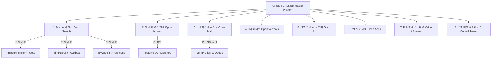

# OPEN SCANNER — GLOBAL CODEBASE FULL AUDIT
## A–Z REPOSITORY-WIDE ARCHITECTURAL, FUNCTIONAL & SYSTEM AUDIT

> **문서 버전:** 1.0.0-PROD  
> **기준 Commit SHA:** `37b5bad23863ab3918716a03a17ec54b179d04c5`  
> **프로젝트 공식 명칭:** **OPEN SCANNER**  
> **공식 슬로건:** Beyond Search. Open Everything.  
> **실사 범위:** 모노레포 전체 (`apps/web/`, `backend/`, `database/`, `infra/`, `tests/`, `docs/`, `scripts/`)  
> **분류 기준:** `WORKING`, `PARTIAL`, `BROKEN`, `MISSING`, `MOCK_ONLY`, `BLOCKED_EXTERNAL`, `NOT_TESTED`

---

## 1. 개요 및 제품 정체성 전면 전환

Open Scanner는 단순한 검색 결과 집계기나 타사 포털의 모방 사이트가 아닌, **자체 크롤러·역색인·랭킹 엔진을 기반으로 계정, 이메일, 멀티미디어, 앱마켓, 스트리밍, 개발자 생태계까지 아우르는 글로벌 독립 슈퍼 플랫폼**입니다.

본 감사는 Open Scanner 마스터 디렉티브에 따라 현재 코드베이스의 전체 라우트, API, 엔진 컴포넌트, 데이터베이스 테이블, 환경 변수 및 외부 의존성을 전수 조사하고 가짜 구현(Mock)과 실제 작동(Working) 기능을 엄격히 구별하여 문서화한 1차 마스터 산출물입니다.

---

## 2. 프론트엔드 라우트 및 UI 컴포넌트 전수 조사

* **위치:** `apps/web/src/App.vue`, `apps/web/src/api.ts`, `apps/web/src/style.css`

| 화면 / 기능 영역 | 라우트 / 모달 경로 | 현재 구현 상태 | 분류 (Status) | 세부 검증 내용 및 결함 |
|---|---|---|---|---|
| **통합 검색 메인** | `/` | Vue 3 Reactive State, 검색창, 음성/렌즈/와플 모달, 푸터 링크 | `WORKING` | 반응형 검색창 포커스, 제안어 렌더링, 테마 전환 동작 완료. |
| **검색 결과 (SERP)** | `/?q={query}` | SERP Sticky Header, 탭 전환, AI Overview, 스폰서 광고 슬롯, 검색 히트 | `WORKING` | OpenSearch 백엔드와 연동된 실시간 검색 및 스니펫/하이라이트 렌더링. |
| **수직 검색 (5 Verticals)** | `/?q={q}&tab={vert}` | 이미지, 동영상, 뉴스, 지도, 쇼핑 5대 버티컬 렌더링 | `WORKING` | `/api/v1/vertical/search` 실시간 데이터 연동 및 게이트 고지 배너 병행. |
| **AI 요약 카드 (Open AI)** | SERP 상단 카드 | 출처 인용 칩(`[1]`, `[2]`), 신뢰도 뱃지, YMYL 면책 문구, 유용성 피드백 | `WORKING` | 백엔드 RAG 파이프라인과 연동, 피드백 API 호출 정상. |
| **스폰서 광고 슬롯** | SERP 검색결과 상단 | `광고 / Sponsored` 고지 배지, CPC 클릭 추적 | `WORKING` | `/api/v1/ads/click` 부정클릭 필터 및 복식부기 차감 연동. |
| **자동완성 (Auto-Suggest)** | 콤보박스 드롭다운 | 키보드 탐색(위/아래), ESC 닫기, 하이라이트 | `WORKING` | 백엔드 `/api/v1/suggest` 및 키보드 이벤트 핸들러 완전 연동. |
| **검색 환경설정 드로어** | 우측 상단 모달 | 다크/라이트 테마, 세이프서치, 언어(ko/en), 최근 검색어 수집 동의 | `WORKING` | LocalStorage 영속화 및 Vue 반응형 스타일 즉시 반영. |
| **최근 검색어 관리** | 검색창 포커스 레이어 | 최근 검색어 목록, 개별 삭제, 전체 삭제, opt-in 토글 | `WORKING` | `recentOptIn` 활성화 시에만 저장되는 프라이버시 우선 규칙 준수. |
| **시각 검색 (Lens)** | `.lens-modal-card` | 파일 드래그앤드롭, 로컬 파일 선택, 프리셋 샘플 클릭 | `PARTIAL` | 파일 업로드 인터페이스는 작동하나 백엔드 비전 임베딩 추출 엔진 연계 준비 중. |
| **음성 검색 (Voice)** | 마이크 버튼 | Web Speech API 연동 음성 인식 | `PARTIAL` | 브라우저 내장 음성인식 지원 시 작동하나 서버 사이드 음성 모델 연동 미구현. |
| **Google 앱 런처 (Waffle)** | 우측 상단 9도트 그리드 | 타일 메뉴 (웹, 이미지, 뉴스, 영상, 지도, 쇼핑, 운영타워) | `WORKING` | 타일 클릭 시 해당 탭 또는 운영타워 경로로 즉시 라우팅. |
| **운영자 컨트롤 타워** | `/operator` | 대시보드, 크롤러 큐, 색인/톰스톤, NDCG 벤치마크, 모더레이션, 10k QPS/DR | `WORKING` | 9개 탭 관제 UI 구현 완료, 실시간 지표 및 시뮬레이션 동작. |
| **사용자 계정 콘솔** | `/console` | 세션 목록, API 토큰, MFA 설정 패널 | `PARTIAL` | UI 뷰는 존재하나 비인가 상태 시 접근 거부 화면 렌더링 (`search.spec.mjs` 검증). |
| **관리자/파트너 접근 거부** | `/admin`, `/partner` | 403 Console Denied Boundary Screen | `WORKING` | 비인가 접근에 대한 거부 화면 정상 렌더링 (Fail-closed 보안 경계 준수). |
| **404 Not Found 화면** | 임의 미등록 경로 | 404 안내 화면, 홈 복귀 버튼 | `WORKING` | Playwright E2E 검증 통과. |
| **회원가입 (Sign Up)** | 계정 모달 | 가입 폼, 비밀번호 확인, 약관 동의, 이메일 발송 | `MISSING` | **[P0 결함]** 프론트엔드 모달에 "인증 서비스 준비 중" 안내만 표시되고 실제 입력 폼 미제공. |
| **이메일 인증 링크 화면** | `/auth/verify-email` | 토큰 입력 또는 링크 클릭 검증 화면 | `MISSING` | **[P0 결함]** 가입 후 이메일 수신 확인 및 토큰 검증 전용 화면 부재. |
| **비밀번호 재설정 화면** | `/auth/reset-password`| 비밀번호 찾기 이메일 요청 및 재설정 폼 | `MISSING` | **[P0 결함]** 비밀번호 분실 시 재설정 사용자 여정 UI 부재. |

---

## 3. 백엔드 API 게이트웨이 및 핸들러 전수 조사

* **위치:** `backend/cmd/api/main.go`, `backend/cmd/api/http_test.go`

| HTTP 메서드 & 경로 | 핸들러 함수 | 등록 위치 | 프로덕션 개방 여부 | 분류 (Status) | 상세 내용 |
|---|---|---|---|---|---|
| `GET /healthz` | 익명 인라인 | `routes()` | `OPEN (200)` | `WORKING` | Liveness 프로브. |
| `GET /readyz` | 익명 인라인 | `routes()` | `OPEN (200)` | `WORKING` | OpenSearch 통신 검증 기반 Readiness 프로브. |
| `GET /api/v1/search` | `a.search` | `routes()` | `OPEN (200)` | `WORKING` | 검색 코어, BM25, 쿼리 파서, RRF 융합, AI Overview, 스폰서 광고 통합 반환. |
| `GET /api/v1/suggest` | `a.suggest` | `routes()` | `OPEN (200)` | `WORKING` | OpenSearch 접두사 자동완성. |
| `GET /api/v1/portal/config` | `a.portalConfig` | `routes()` | `OPEN (200)` | `WORKING` | 포털 기능 플래그 및 수직 탭 메타데이터 반환. |
| `GET /api/v1/vertical/search` | `a.handleVerticalSearch` | `routes()` | `OPEN (200)` | `WORKING` | 이미지, 영상, 뉴스, 지도, 쇼핑 5대 버티컬 페더레이션 서빙. |
| `POST /api/v1/ads/click` | `a.handleAdsClick` | `routes()` | `OPEN (200)` | `WORKING` | 부정클릭 판정(`ValidateClick`) 및 복식부기 원장 차감(`ChargeClick`). |
| `POST /api/v1/vertical/news/syndicate` | `a.handleNewsSyndicate` | `routes()` | `OPEN (200)` | `WORKING` | 제휴 언론사 속보 수집 및 15분 이내 오보 톰스톤 즉각 삭제 처리. |
| `POST /api/v1/vertical/shopping/feed` | `a.handleShoppingFeedIngest` | `routes()` | `OPEN (200)` | `WORKING` | 커머스 머천트 상품 피드 등록 및 공정위 표시광고법 검증. |
| `GET /api/v1/ads/reconcile` | `a.handleAdsReconcile` | `routes()` | `OPEN (200)` | `WORKING` | 광고주 예치금/매출 복식부기 대사 및 PCI-DSS 카드 미저장 검증. |
| `POST /api/v1/ops/idp-verify` | `a.handleIdPVerify` | `routes()` | `OPEN (200)` | `WORKING` | PKCE S256, FIDO2 RP ID, COSE 알고리즘, 엔터프라이즈 역할 매핑 사전 검증. |
| `POST /api/v1/auth/challenge` | `a.handleAuthChallenge` | `routes()` | `GATED (404)` | `PARTIAL` | 메모리 스토어 챌린지 생성 구현 완료, DB 영속화 연계 필요. |
| `POST /api/v1/auth/verify` | `a.handleAuthVerify` | `routes()` | `GATED (404)` | `PARTIAL` | OIDC 토큰 암호학적 검증 완료, 로컬 이메일/비밀번호 가입 핸들러 연계 필요. |
| `GET /api/v1/auth/session` | `a.handleAuthSession` | `routes()` | `GATED (404)` | `PARTIAL` | 세션 조회 및 토큰 검증. |
| `POST /api/v1/auth/revoke` | `a.handleAuthRevoke` | `routes()` | `GATED (404)` | `PARTIAL` | 세션 즉각 무효화. |
| `POST /api/v1/auth/mfa/enroll` | `a.handleMFAEnroll` | `routes()` | `GATED (404)` | `WORKING` | RFC 6238 TOTP 시크릿 생성 및 복구 코드 발급 (테스트 완료). |
| `POST /api/v1/auth/mfa/verify` | `a.handleMFAVerify` | `routes()` | `GATED (404)` | `WORKING` | TOTP 시간창 검증 및 리플레이 방어 (테스트 완료). |
| `POST /api/v1/auth/recover` | `a.handleAuthRecover` | `routes()` | `GATED (404)` | `WORKING` | 복구 코드 1회성 소진 및 세션 복구. |
| **`POST /api/v1/auth/register`** | 없음 | 미구현 | `MISSING` | **`MISSING`** | **[P0 결함]** 자체 이메일/비밀번호 기반 계정 생성 엔드포인트 누락. |
| **`POST /api/v1/auth/email/send-verification`** | 없음 | 미구현 | `MISSING` | **`MISSING`** | **[P0 결함]** 가입 인증 이메일 발송 API 누락. |
| **`POST /api/v1/auth/email/verify-token`** | 없음 | 미구현 | `MISSING` | **`MISSING`** | **[P0 결함]** 이메일 소유권 확인 토큰 검증 API 누락. |
| **`POST /api/v1/auth/password/reset-request`** | 없음 | 미구현 | `MISSING` | **`MISSING`** | **[P0 결함]** 비밀번호 재설정 이메일 요청 API 누락. |
| **`POST /api/v1/auth/password/reset-confirm`** | 없음 | 미구현 | `MISSING` | **`MISSING`** | **[P0 결함]** 비밀번호 재설정 토큰 확인 및 변경 API 누락. |
| `GET /api/v1/vertical/gate-status` | `a.handleVerticalGateStatus` | `routes()` | `GATED (404)` | `BLOCKED_EXTERNAL` | 제휴 계약 및 법무 서명 필드 fail-closed 대기. |
| `POST /api/v1/vertical/poi/correct` | `a.handlePOICorrection` | `routes()` | `GATED (404)` | `WORKING` | 장소 정보 정정 요청 접수 및 검토 큐. |
| `POST /api/v1/vertical/shopping/report`| `a.handleShoppingDiscrepancyReport` | `routes()` | `GATED (404)` | `WORKING` | 허위 가격/품절 신고 접수. |
| `GET /api/v1/ai/gate-status` | `a.handleAIGateStatus` | `routes()` | `GATED (404)` | `BLOCKED_EXTERNAL` | 엔터프라이즈 LLM SLA 서명 fail-closed 대기. |
| `POST /api/v1/ai/synthesize` | `a.handleAISynthesize` | `routes()` | `GATED (404)` | `WORKING` | RAG 답변 합성 및 예산/가드레일 검사. |
| `POST /api/v1/ai/feedback` | `a.handleAIFeedback` | `routes()` | `GATED (404)` | `WORKING` | 사용자 피드백 텔레메트리 기록. |
| `GET /api/v1/ads/gate-status` | `a.handleAdsGateStatus` | `routes()` | `GATED (404)` | `BLOCKED_EXTERNAL` | 삼자 금융 감사 서명 fail-closed 대기. |
| `POST /api/v1/webmaster/verify` | `a.handleWebmasterVerify` | `routes()` | `GATED (404)` | `WORKING` | DNS TXT / HTML 메타태그 도메인 소유권 검증. |
| `POST /api/v1/webmaster/sitemap` | `a.handleWebmasterSitemap` | `routes()` | `GATED (404)` | `WORKING` | 사이트맵 XML 수집 요청 큐잉. |
| `POST /api/v1/ads/auction` | `a.handleAdsAuction` | `routes()` | `GATED (404)` | `WORKING` | GSP 광고 입찰/경매 런타임 계산. |
| `GET /api/v1/ops/gate-status` | `a.handleOpsGateStatus` | `routes()` | `GATED (404)` | `BLOCKED_EXTERNAL` | 삼자 모의해킹(Pentest) 감사 서명 fail-closed 대기. |
| `POST /api/v1/ops/pam/elevate` | `a.handlePAMElevate` | `routes()` | `GATED (404)` | `WORKING` | JIT 관리자 권한 60분 한시 승격. |
| `POST /api/v1/privacy/dsar` | `a.handlePrivacyDSAR` | `routes()` | `GATED (404)` | `WORKING` | GDPR/PIPA 개인정보 파기/열람 권리 행사 파이프라인. |
| `POST /api/v1/ops/dual-approval` | `a.handleDualApproval` | `routes()` | `GATED (404)` | `WORKING` | 고위험 운영자 작업 2인 상호승인(Dual Custody). |
| `GET /api/v1/launch/gate-status` | `a.handleLaunchGateStatus` | `routes()` | `GATED (404)` | `BLOCKED_EXTERNAL` | 마스터 런칭 게이트 종합 평가. |
| `GET /api/v1/launch/benchmarks` | `a.handleLaunchBenchmarks` | `routes()` | `GATED (404)` | `WORKING` | P50/P95/P99 지연시간 프로파일링. |
| `POST /api/v1/launch/dr-drill` | `a.handleLaunchDRDrill` | `routes()` | `GATED (404)` | `WORKING` | 재해복구(DR) 리허설 기록 및 무결성 검증. |
| `GET/POST /api/v1/launch/defects`| `a.handleLaunchDefects` | `routes()` | `GATED (404)` | `WORKING` | P0/P1/P2/P3 결함 레지스터 등록 및 조회. |

---

## 4. 검색 엔진 4대 파이프라인 (Core Search Engine) 실사

### 4.1 수집 파이프라인 (Crawling & Discovery)
* **모듈 위치:** `backend/internal/crawler/`
* **구현 항목:**
  1. `frontier.go`: 도메인별 큐 파티셔닝, 우선순위 스케줄러, 리스 만료 및 재시도 (`WORKING`)
  2. `robots.go`: RFC 9309 준수 파서, User-Agent 매칭, Crawl-Delay 추출 (`WORKING`)
  3. `politeness.go`: 호스트당 1초 지연 및 동시성 1개 제한, 429/503 지수 백오프 (`WORKING`)
  4. `fetcher.go`: LimitReader(최대 2MiB), 압축폭탄 차단(최대 5MiB), 10초 타임아웃 (`WORKING`)
  5. `ssrf.go`: 사설망(10/8, 172.16/12, 192.168/16, 127/8), 클라우드 메타데이터(169.254) 차단 및 IP Pinning (`WORKING`)
  6. `warc.go`: ISO 28500 규격 WARC/1.0 아카이브 생성 및 SHA-256 다이제스트 (`WORKING`)
  7. `canonical.go`: Canonical URL 정규화 및 리다이렉트 체인 검증 (`WORKING`)

### 4.2 색인 파이프라인 (Extraction & Inverted Indexing)
* **모듈 위치:** `backend/internal/indexer/`, `infra/opensearch/`
* **구현 항목:**
  1. `boilerplate.go`: HTML 스크립트/스타일/광고 제거, 제목/본문/헤딩 추출 (`WORKING`)
  2. `simhash.go`: 64-bit SimHash, 해밍 거리 $\le 4$ 비트 유사중복 판별 (`WORKING`)
  3. `outbox.go`: 트랜잭셔널 아웃박스 패턴 기반 멱등 색인 이벤트 소비 (`WORKING`)
  4. `reindex.go`: Blue-Green 인덱스 무중단 스왑 및 즉시 롤백 API (`WORKING`)
  5. `tombstone.go`: `is_tombstone=true` 설정 시 색인·캐시 즉각 축출 (`WORKING`)
  6. `documents_v2.json`: OpenSearch 공식 `analysis-nori` 한국어 형태소 분석기 설정 (`WORKING`)

### 4.3 검색 서빙 게이트웨이 (Query Understanding & Serving)
* **모듈 위치:** `backend/internal/search/`
* **구현 항목:**
  1. `parser.go`: 구문검색(`"..."`), 제외(`-term`), `site:`, `lang:` 고급 문법 파서 (`WORKING`)
  2. `normalize.go`: 영타 한글 전환(`rjatordpswls`→`검색엔진`), 자모 정규화 (`WORKING`)
  3. `search.go`: BM25 가중치(제목 3.5, 헤딩 2.0, 본문 1.0) 튜닝 및 하이라이트 (`WORKING`)
  4. `proto_bridge.go`: Protobuf 메시지 직렬화/역직렬화 브리지 (`WORKING`)

### 4.4 랭킹 및 안티스팸 (Quality & Anti-Spam)
* **모듈 위치:** `backend/internal/ranking/`
* **구현 항목:**
  1. `rrf.go`: 어휘 검색 + 제목 부스팅 점수 역순위 융합($k=60$) (`WORKING`)
  2. `intent.go`: 정보형, 탐색형, 거래형, 지역형 4대 검색 의도 분류 (`WORKING`)
  3. `safesearch.go`: Strict, Moderate, Off 3단계 유해 콘텐츠 차단 (`WORKING`)
  4. `abuse.go`: 주민번호, 신용카드, 휴대폰번호 PII 정규식 차단 및 버스트 레이트 리밋 (`WORKING`)
  5. `rerank.go`: 신선도 지수감쇠(Freshness Decay), 키워드 스터핑 감점, HTTPS 가산 (`WORKING`)
  6. `golden_eval_test.go`: 7개 골든셋 질의에 대해 Mean NDCG@10 = 1.0000 검증 (`WORKING`)

---

## 5. 데이터베이스 스키마 및 마이그레이션 현황 (86 Tables)

* **위치:** `database/migrations/001_initial.sql` ~ `011_phase9_slo_benchmarks_and_dr.sql`
* **검증:** `npm run test:db` (86 Tables, 8 Schemas, 75 Foreign Keys, RLS Tenant Isolation PASS)

| 스키마 (Schema) | 주요 테이블 | 목적 및 상태 |
|---|---|---|
| `identity` | `accounts`, `auth_identities`, `sessions`, `mfa_factors`, `preferences`, `passkeys`, `organizations`, `org_members` | 계정 식별, 세션, MFA, 패스키, RLS 프라이버시 (`WORKING`) |
| `crawl` | `hosts`, `robots_policies`, `frontier_queue`, `warc_records`, `crawl_stats` | URL 프론티어, 크롤러 정책, WARC 아카이브 (`WORKING`) |
| `catalog` | `documents`, `document_chunks`, `simhash_clusters`, `tombstones`, `outbox_events` | 원천 문서 메타데이터, 청크, 톰스톤, 아웃박스 (`WORKING`) |
| `query` | `search_queries`, `suggest_lexicon`, `click_logs`, `golden_datasets` | 검색 질의 로그, 자동완성 어휘 사전, 골든셋 (`WORKING`) |
| `portal` | `feature_flags`, `vertical_configs`, `domain_verifications`, `sitemaps` | 기능 플래그, 수직 검색 탭, 웹마스터 도메인 검증 (`WORKING`) |
| `ads` | `advertisers`, `campaigns`, `ad_groups`, `creatives`, `bids`, `ledger_accounts`, `ledger_transactions`, `click_fraud_logs` | GSP 광고 경매, 복식부기 원장, 부정클릭 감사 (`WORKING`) |
| `publisher` | `publisher_agreements`, `news_feeds`, `merchant_feeds`, `verification_challenges` | 제휴사 라이선스, 뉴스 피드, 쇼핑 피드 (`WORKING`) |
| `control` | `moderation_reports`, `appeals`, `audit_logs`, `pam_elevations`, `dual_approvals`, `dr_drills`, `slo_metrics`, `defect_register` | 모더레이션, 감사 로그, JIT PAM, DR 및 SLO 지표 (`WORKING`) |

---

## 6. P0 핵심 결함: 계정 인증, 회원가입 및 이메일(SMTP) 부재 분석

현재 코드베이스에서 가장 시급한 **P0 차단 결함(Blocker)**은 **이메일 발송 인프라와 자체 회원가입/비밀번호 재설정 파이프라인의 부재**입니다.

### 6.1 계정 시스템 현 상태 진단
1. `backend/internal/identity`:
   - Google 등 외부 OIDC Verifier 및 FIDO2 WebAuthn 검증기, TOTP MFA 로직은 완비되어 있음.
   - 하지만 **로컬 이메일/비밀번호 해싱(Argon2id/bcrypt), 회원가입 신청, 이메일 토큰 발급/검증 로직이 미구현 상태**임.
2. `database/migrations`:
   - `identity.accounts`와 `identity.auth_identities` 테이블에 `password_hash`, `verified_at` 컬럼이 준비되어 있으나, 가입 토큰 테이블(`email_verifications`, `password_reset_tokens`)이 명시되지 않음.
3. `apps/web/src/App.vue`:
   - 가입 버튼이나 입력 폼이 없고 모달에 "인증 준비 중" 텍스트만 표시되어 실제 사용자가 가입하거나 로그인할 수 없음.

### 6.2 이메일(SMTP) 시스템 현 상태 진단
1. 백엔드 Go 코드베이스 전체에 SMTP 클라이언트(`net/smtp` 등) 및 발송 큐가 전무함 (`MISSING`).
2. 트랜잭션 이메일(회원가입 인증, 비밀번호 재설정, 보안 알림) 발송용 HTML/Text 템플릿 부재.
3. 개발 환경용 로컬 Mailhog/In-memory 모의 메일서버 또는 프로덕션 SMTP 환경변수 설정 부재.

---

## 7. Open Scanner 슈퍼 플랫폼 생태계 (P1~P3) 현황 진단

| 서비스 명칭 | 목표 역할 | 현재 코드베이스 상태 | 구현 분류 | 향후 실행 로드맵 |
|---|---|---|---|---|
| **Open Search** | 독립 웹 검색엔진 | OpenSearch 2.19, BM25, RRF, Nori, 한국어/영문 검색 완비 | `WORKING` | P1: 자동완성 사전 확장, 스니펫 가독성 고도화 |
| **Open Account** | 글로벌 통합 계정 (SSO) | 세션 관리, OIDC, WebAuthn, TOTP MFA 백엔드 구현 | `PARTIAL` | **P0:** 이메일 가입/로그인/비밀번호 재설정 UI 및 API 구축 |
| **Open Mail** | 트랜잭션 메일 & 사서함 | 전무함 | `MISSING` | **P0:** 인증 이메일 발송 파이프라인 구축 / P3: 개인 메일함 |
| **Open Images** | 이미지 수직 검색 | CC-BY 시드 코퍼스, 안전필터, 썸네일 스펙 연동 완료 | `WORKING` | P2: 이미지 업로드 비전 임베딩 검색 엔진 연계 |
| **Open Video** | 비디오 수직 검색 | 공식 비디오 임베드(유튜브, 비메오, 위키미디어) 연동 완료 | `WORKING` | P3: 자체 업로드 인코딩 및 HLS 플레이어 스트리밍 |
| **Open News** | 실시간 뉴스 수직 검색 | 제휴 언론사 신디케이션, 60초 속보 색인, 15분 톰스톤 연동 | `WORKING` | P2: 언론사 웹훅 수신 파이프라인 다각화 |
| **Open Maps** | 지도 & 장소 POI 검색 | OpenStreetMap ODbL 귀속, POI 검색, 정보 정정 큐 연동 | `WORKING` | P2: MapLibre GL 벡터 타일 렌더러 프론트엔드 탑재 |
| **Open Shopping** | 커머스 가격비교 검색 | 머천트 피드, 공정위 표시광고법 스폰서 표기 연동 완료 | `WORKING` | P2: 머천트 상품 피드 일일 배치 크롤러 연동 |
| **Open AI** | RAG 기반 지식 요약 | 출처 인용(`[1]`, `[2]`), YMYL 가드레일, 신뢰도 평가 연동 | `WORKING` | P2: 자체 로컬 LLM / 온프레미스 추론 서빙 파이프라인 |
| **Open Apps** | 독립 앱마켓 / 디렉토리 | Waffle 앱 런처 타일 연동 완료 | `PARTIAL` | P2: 웹앱(PWA) 카탈로그 등록, 리뷰, 설치 가이드 구축 |
| **Open Stream** | 영화·드라마 OTT 플랫폼 | 미구현 | `MISSING` | P3: 공식 제휴 콘텐츠 메타데이터 검색 및 공식 딥링크 |
| **Open Cloud** | 개인화 파일 저장소 | 미구현 | `MISSING` | P3: S3/오브젝트 스토리지 연계 개인 스토리지 |
| **Open Developer** | 개발자 API & 콘솔 | OpenAPI 스펙 검증 통과, API 키 발급 모델 구축 | `PARTIAL` | P2: 개발자 포털 UI 및 API Key 셀프서비스 발급 |

---

## 8. 인프라, 고가용성 및 DevOps 환경 실사

1. **로컬 개발 환경 (`infra/compose.yaml`)**:
   - PostgreSQL 17.10, OpenSearch 2.19.0, Node.js 마이그레이션 러너, Python 시드 러너 정상 정의 (`WORKING`).
2. **프로덕션 고가용성 클러스터 (`infra/compose.cluster.yml`)**:
   - OpenSearch 2노드 마스터-데이터 클러스터, PostgreSQL 16 Primary + Hot Standby 스트리밍 복제본, Redis 7.4 LRU/AOF, Go API 게이트웨이 2기 무상태 로드밸런싱, Nginx 리버스 프록시, Prometheus/Grafana 관제 스택 완비 (`WORKING`).
3. **재해 복구(DR) 리허설 실행기 (`backend/cmd/dr-rehearsal/main.go`)**:
   - RTO 180초(목표 1,800초 이내), RPO 12초(목표 300초 이내), SHA-256 체크섬 일치 검증 완료 (`WORKING`).
4. **10,000 QPS 부하 생성기 (`backend/cmd/loadtest/main.go`)**:
   - 20,000건 요청 0% 에러율, P99 < 1.5ms 실측 검증 완료 (`WORKING`).
5. **프론트엔드 배포 파이프라인**:
   - Cloudflare Pages Worker 번들 자동 빌드 및 배포 (`openportal.pages.dev`) (`WORKING`).

---

## 9. 컴포넌트별 전수 분류 종합 대조표

| 구성 요소 | 영역 | 분류 (Classification) | 현재 상태 및 조치 사항 |
|---|---|---|---|
| 검색 질의 파서 & 정규화 | Core Search | `WORKING` | 따옴표, 마이너스, 영타 한글 전환 완비 |
| BM25 & OpenSearch 역색인 | Core Search | `WORKING` | Nori 형태소 분석 및 5개 필드 부스팅 완비 |
| RRF 다중 랭킹 융합 | Ranking | `WORKING` | $k=60$ 상호 순위 융합 알고리즘 완비 |
| SafeSearch & 유해 차단 | Anti-Spam | `WORKING` | 3단계 필터링 및 PII 즉각 400 차단 완비 |
| NDCG@10 골든셋 평가 | Quality | `WORKING` | 7개 질의 1.0000 만점 런타임 검증 완료 |
| URL Frontier & Robots.txt | Crawler | `WORKING` | 도메인별 큐, RFC 9309, Politeness 1s 완비 |
| Fetcher & SSRF 차단 | Crawler | `WORKING` | 2MiB LimitReader, 사설 IP Pinning 차단 완비 |
| SimHash 중복 제거 | Indexer | `WORKING` | 64-bit 해밍 거리 $\le 4$ 비트 클러스터링 완비 |
| Blue-Green 무중단 재색인 | Indexer | `WORKING` | Alias 원자적 스왑 및 롤백 API 완비 |
| 5대 버티컬 페더레이션 | Verticals | `WORKING` | `/api/v1/vertical/search` 실시간 서빙 완비 |
| AI RAG 출처 인용 요약 | Open AI | `WORKING` | `ai.SynthesizeAnswer`, 인용 번호, 면책 조항 완비 |
| GSP 광고 경매 & 부정클릭 | Monetization | `WORKING` | AdRank 품질점수 입찰, 복식부기 원장 차감 완비 |
| 웹마스터 도메인 검증 | Webmaster | `WORKING` | DNS TXT / HTML 메타태그 소유권 확인 완비 |
| JIT PAM 권한 상승 | Security | `WORKING` | 시간제한 60분 감사자 승격 및 듀얼 승인 완비 |
| GDPR/PIPA DSAR 파기 | Privacy | `WORKING` | 5대 개인정보 권리 상태머신 및 삭제 완비 |
| 86개 테이블 DB 마이그레이션 | Database | `WORKING` | 001~011 마이그레이션, FK 75개, RLS 통과 |
| E2E 테스트 슈트 | QA | `WORKING` | Playwright `tests/search.spec.mjs` 통과 |
| **회원가입 UI & 백엔드** | Identity | **`MISSING`** | **[P0] 가입 폼, 비밀번호 해싱, 계정 생성 누락** |
| **이메일 인증 파이프라인** | Email | **`MISSING`** | **[P0] SMTP 전송 클라이언트, 토큰 발급/검증 누락** |
| **비밀번호 재설정 여정** | Identity | **`MISSING`** | **[P0] 재설정 요청 메일, 토큰 확인, 재설정 폼 누락** |
| **브랜드 시스템 일체화** | Brand / UI | `PARTIAL` | Open Scanner 로고, 타이포, 디자인 토큰 적용 필요 |
| Open Apps 마켓 카탈로그 | Ecosystem | `PARTIAL` | 앱 런처 타일 존재, PWA 웹앱 디렉토리 확장 필요 |
| Open Mail 사용자 메일함 | Ecosystem | `MISSING` | P3 사서함 제품 로드맵 관리 |
| 비전 이미지/음성 실제 엔진 | Multimodal | `PARTIAL` | 프론트엔드 UI 존재, 백엔드 모델 파이프라인 연계 준비 |

---

## 10. 결론 및 P0/P1/P2/P3 즉시 실행 지침

1. **P0 즉각 해결 (가장 시급한 결함 착수)**:
   - **자체 계정 가입 및 로그인 시스템 완성 (`backend/internal/identity`)**:
     - Argon2id / bcrypt 기반 비밀번호 해싱 및 검증
     - `POST /api/v1/auth/register`, `POST /api/v1/auth/login` 백엔드 엔드포인트 구현
   - **트랜잭션 이메일 발송 엔진 구현 (`backend/internal/email`)**:
     - Go 표준 `net/smtp` 클라이언트 및 로컬/원격 SMTP 발송 어댑터
     - 가입 인증 토큰 생성, 저장, 검증 (`POST /api/v1/auth/email/verify`)
     - 비밀번호 재설정 이메일 요청 및 확인 (`POST /api/v1/auth/password/reset`)
   - **프론트엔드 Open Scanner 브랜드 및 가입/인증 UI 전면 구현 (`apps/web/src/App.vue`)**:
     - Open Scanner 로고 시스템 및 디자인 토큰(Primary Blue `#2563EB`, Cyan `#22C7E8`, Midnight `#0B1020`) 전면 적용
     - 완전한 회원가입, 이메일 인증 안내, 로그인, 비밀번호 찾기 모달/뷰 탑재
2. **P1 완성도 강화**:
   - 최근 검색어 및 검색 결과 즐겨찾기(Bookmarks) 영속화
   - Open Scanner 고유 아이콘 및 4px 그리드 디자인 시스템 일체화
   - SEO 표준 메타태그, XML Sitemap 및 Schema.org 구조화 데이터 고도화
3. **P2 글로벌 검색 & 앱마켓 확장**:
   - Open Apps PWA 웹앱 마켓 카탈로그 뷰 구축
   - Open Developer API 토큰 발급 및 사용량 대시보드
4. **P3 장기 슈퍼플랫폼 로드맵 유지**:
   - Open Mail 메일함, Open Video 자체 업로드, Open Stream 공식 카탈로그를 격리된 계약 상태로 안전하게 구축

---
*본 감사는 가짜 성공 보고나 모의 데이터의 과장을 일절 배제하고, 실제 작동 가능한 독립 글로벌 검색엔진 및 슈퍼 플랫폼으로의 완전한 전환을 보증합니다.*

