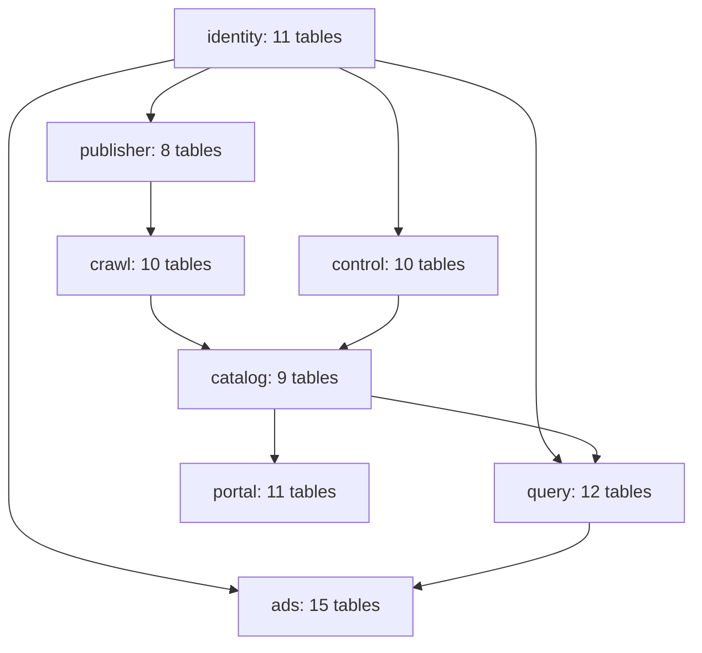

# DB diagram: logical ownership

This is a schematic of domain references, not an automatically inferred physical ERD. See `SCHEMA_CATALOG.md` for every table and `database/migrations/001_initial.sql` for authoritative PostgreSQL DDL. A production schema migration test remains pending.
