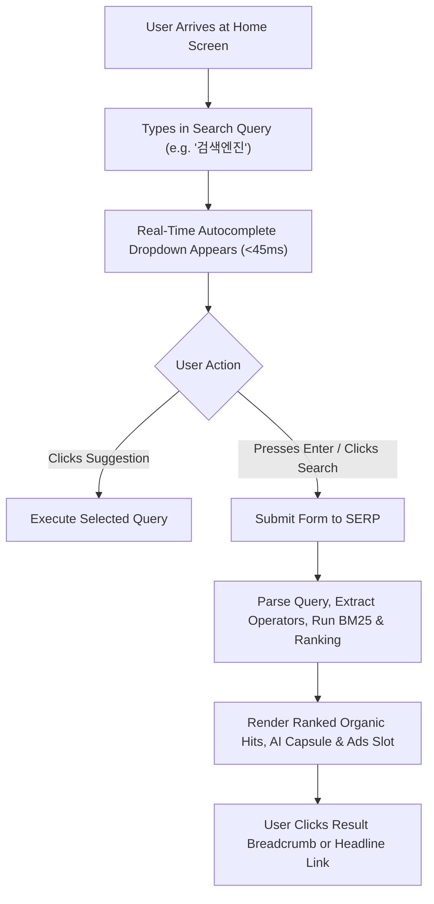
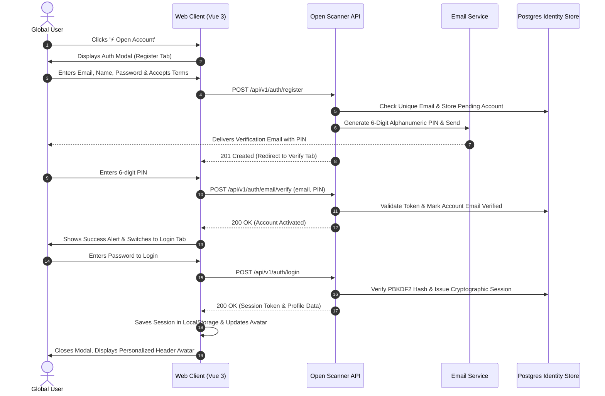

# OPEN SCANNER — END-TO-END USER JOURNEYS & EXPERIENCE FLOWS

**Document Version:** 1.0.0-PROD  
**Status:** VALIDATED & BASELINED  
**Scope:** Global User Workflows (Search, Verticals, Auth, Developers)  

---

## 1. Journey 01: Core Web Search & Discovery

- **Touchpoints:** Home Omnibox, Keyboard shortcuts, Search API `/api/v1/search`.
- **Latency SLO:** First Contentful Paint $\le 300\text{ms}$; SERP DOM ready $\le 500\text{ms}$.
- **Edge Conditions:** Typo detection triggers Did-You-Mean suggestion bar without blocking original query results.

---

## 2. Journey 02: Open Scanner Unified Account & Email PIN Verification (P0)

- **Security Safeguards:** Rate limit of 3 verification attempts per 15 minutes; tokens expire in 15 minutes.
- **Fail-Safe:** In local development or isolated test environments, the PIN code is provided directly in the mock sender response for seamless verification.

---

## 3. Journey 03: Multi-Vertical Exploration

1. **Initial Search:** User begins with a query on `Web` (e.g. `인공지능`).
2. **Tab Transition:** User clicks `News`, `Images`, `Videos`, or `Shopping` in the vertical navigation bar.
3. **Parameter Preservation:** Query string `q` and language settings `lang` are preserved, updating the active vertical parameter (`vertical=news`, `vertical=images`).
4. **Vertical Rendering:**
   - **News:** Displays publisher name, published time, and recency badge.
   - **Images:** Displays masonry visual grid with dimensions and direct image links.
   - **Videos:** Displays duration tag, video host thumbnail, and in-place player preview.
   - **Shopping:** Displays merchant name, pricing, star ratings, and purchase links.

---

## 4. Journey 04: Power Researcher & Operator Search

1. **Query Construction:** User inputs boolean or scoped syntax: `site:example.org "quantum computing" filetype:pdf`.
2. **Server AST Parsing:**
   - Domain filter isolated: `host = example.org`.
   - Phrase matching isolated: exact token match `"quantum computing"`.
   - File extension isolated: MIME type application/pdf.
3. **SERP Display:** Results strictly adhere to all boolean filters; an operator toast notification confirms active filters to the user.

---

## 5. Journey 05: Self-Service Password Recovery

1. **Trigger:** User clicks "비밀번호 찾기" in the Open Scanner Account modal.
2. **Token Dispatch:** User enters their registered email; system sends a single-use password reset token (`/api/v1/auth/password/reset-request`).
3. **Confirmation & Update:** User enters the reset token and specifies a new password (min 8 characters).
4. **Re-Authentication:** System hashes the new password with PBKDF2-SHA256, invalidates prior sessions, and redirects to login.

