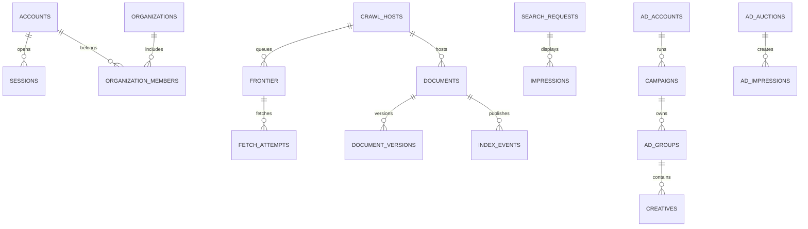

# OpenPortal Search — 전체 PostgreSQL 스키마 카탈로그

본 스키마는 86개 테이블의 **설계용 기준 마이그레이션**이다. 테이블 생성은 운영 기능 구현 또는 검색 데이터 인덱싱 완료를 의미하지 않는다.
객체 저장소에는 원문/미디어, OpenSearch에는 역색인, PostgreSQL에는 진실 원장/운영 메타만 저장한다.

## identity — 계정·인증·권한 (11개)

| 테이블 | 키/관계 | 목적/주요 컬럼 |
|---|---|---|
| `identity.accounts` | PK `id`;  | `id, email, display_name, status, locale` 등 |
| `identity.auth_identities` | PK `id`; account_id→identity.accounts | `id, account_id, provider, provider_subject, password_hash` 등 |
| `identity.sessions` | PK `id`; account_id→identity.accounts | `id, account_id, token_hash, expires_at, revoked_at` 등 |
| `identity.mfa_factors` | PK `id`; account_id→identity.accounts | `id, account_id, factor_type, secret_ciphertext, enrolled_at` 등 |
| `identity.preferences` | PK `account_id`; account_id→identity.accounts | `account_id, safe_search, theme, language, personalized_search` 등 |
| `identity.organizations` | PK `id`;  | `id, name, org_type, verified_at, created_at` 등 |
| `identity.organization_members` | PK `organization_id,account_id`; organization_id→identity.organizations, account_id→identity.accounts | `organization_id, account_id, role, joined_at` 등 |
| `identity.roles` | PK `id`;  | `id, description` 등 |
| `identity.account_roles` | PK `account_id,role_id`; account_id→identity.accounts, role_id→identity.roles | `account_id, role_id, granted_at` 등 |
| `identity.api_credentials` | PK `id`; organization_id→identity.organizations, account_id→identity.accounts | `id, organization_id, account_id, key_prefix, secret_hash` 등 |
| `identity.consent_records` | PK `id`; account_id→identity.accounts | `id, account_id, consent_type, version, granted` 등 |

## crawl — URL 발견·크롤링 (10개)

| 테이블 | 키/관계 | 목적/주요 컬럼 |
|---|---|---|
| `crawl.hosts` | PK `id`;  | `id, scheme, hostname, port, fetch_enabled` 등 |
| `crawl.robots_cache` | PK `host_id`; host_id→crawl.hosts | `host_id, fetched_at, expires_at, status_code, body_object_key` 등 |
| `crawl.sitemaps` | PK `id`; host_id→crawl.hosts | `id, host_id, url, last_fetched_at, error_count` 등 |
| `crawl.seed_sources` | PK `id`;  | `id, source_type, source_uri, license, enabled` 등 |
| `crawl.frontier` | PK `id`; host_id→crawl.hosts | `id, host_id, url, url_hash, priority` 등 |
| `crawl.fetch_attempts` | PK `id`; frontier_id→crawl.frontier | `id, frontier_id, started_at, finished_at, status_code` 등 |
| `crawl.raw_objects` | PK `id`; frontier_id→crawl.frontier | `id, frontier_id, object_key, mime_type, bytes` 등 |
| `crawl.discovered_urls` | PK `id`; source_frontier_id→crawl.frontier | `id, source_frontier_id, target_url, anchor_text, discovered_at` 등 |
| `crawl.crawl_rules` | PK `id`; host_id→crawl.hosts | `id, host_id, rule_type, pattern, reason` 등 |
| `crawl.url_submissions` | PK `id`; submitted_by→identity.accounts | `id, submitted_by, url, status, created_at` 등 |

## catalog — 검색 문서·색인 (9개)

| 테이블 | 키/관계 | 목적/주요 컬럼 |
|---|---|---|
| `catalog.documents` | PK `id`; host_id→crawl.hosts | `id, canonical_url, canonical_hash, host_id, title` 등 |
| `catalog.document_versions` | PK `id`; document_id→catalog.documents, raw_object_id→crawl.raw_objects | `id, document_id, raw_object_id, content_hash, extracted_object_key` 등 |
| `catalog.document_links` | PK `source_document_id,target_document_id`; source_document_id→catalog.documents, target_document_id→catalog.documents | `source_document_id, target_document_id, rel_nofollow, anchor, created_at` 등 |
| `catalog.canonical_aliases` | PK `alias_url`; document_id→catalog.documents | `alias_url, document_id, reason, updated_at` 등 |
| `catalog.index_events` | PK `id`; document_id→catalog.documents | `id, document_id, operation, state, payload_version` 등 |
| `catalog.index_runs` | PK `id`;  | `id, index_alias, physical_index, status, started_at` 등 |
| `catalog.embedding_metadata` | PK `document_id,model_version`; document_id→catalog.documents | `document_id, model_version, vector_store_key, embedding_dimensions, created_at` 등 |
| `catalog.index_policies` | PK `id`;  | `id, scope_pattern, policy, enabled, changed_at` 등 |
| `catalog.removal_tombstones` | PK `id`;  | `id, canonical_hash, reason, requested_at, processed_at` 등 |

## query — 검색 요청·품질 (12개)

| 테이블 | 키/관계 | 목적/주요 컬럼 |
|---|---|---|
| `query.requests` | PK `id`;  | `id, query_hash, query_normalized, locale, vertical` 등 |
| `query.impressions` | PK `id`; request_id→query.requests, document_id→catalog.documents | `id, request_id, document_id, position, surface` 등 |
| `query.clicks` | PK `id`; request_id→query.requests, document_id→catalog.documents | `id, request_id, document_id, position, occurred_at` 등 |
| `query.suggestions` | PK `id`;  | `id, phrase, locale, source, normalized_phrase` 등 |
| `query.synonym_sets` | PK `id`;  | `id, locale, name, version, enabled` 등 |
| `query.synonyms` | PK `id`; set_id→query.synonym_sets | `id, set_id, source_term, target_term, weight` 등 |
| `query.rewrites` | PK `id`;  | `id, source_pattern, replacement, locale, priority` 등 |
| `query.ranking_profiles` | PK `id`;  | `id, name, version, config, active` 등 |
| `query.experiments` | PK `id`;  | `id, name, status, variants, started_at` 등 |
| `query.quality_judgments` | PK `id`; document_id→catalog.documents, reviewer_id→identity.accounts | `id, query_text, document_id, relevance, reviewer_id` 등 |
| `query.evaluation_runs` | PK `id`; ranking_profile_id→query.ranking_profiles | `id, ranking_profile_id, dataset_version, metrics, started_at` 등 |
| `query.zero_result_queries` | PK `id`;  | `id, query_hash, locale, first_seen_at, last_seen_at` 등 |

## portal — 수직검색·콘텐츠 (11개)

| 테이블 | 키/관계 | 목적/주요 컬럼 |
|---|---|---|
| `portal.media_assets` | PK `id`;  | `id, object_key, mime_type, size_bytes, license` 등 |
| `portal.images` | PK `id`; document_id→catalog.documents, asset_id→portal.media_assets | `id, document_id, asset_id, source_url, alt_text` 등 |
| `portal.videos` | PK `id`; document_id→catalog.documents | `id, document_id, provider, external_id, video_url` 등 |
| `portal.news_publishers` | PK `id`;  | `id, name, website, feed_url, licensed` 등 |
| `portal.news_articles` | PK `id`; document_id→catalog.documents, publisher_id→portal.news_publishers | `id, document_id, publisher_id, url, headline` 등 |
| `portal.places` | PK `id`;  | `id, name, address, latitude, longitude` 등 |
| `portal.place_reviews` | PK `id`; place_id→portal.places, account_id→identity.accounts | `id, place_id, account_id, rating, body` 등 |
| `portal.product_offers` | PK `id`; merchant_org_id→identity.organizations | `id, product_key, merchant_org_id, title, landing_url` 등 |
| `portal.knowledge_entities` | PK `id`;  | `id, entity_key, name, entity_type, summary` 등 |
| `portal.modules` | PK `id`;  | `id, module_key, display_name, config, enabled` 등 |
| `portal.module_items` | PK `id`; module_id→portal.modules, asset_id→portal.media_assets | `id, module_id, title, target_url, asset_id` 등 |

## ads — 광고·결제 (15개)

| 테이블 | 키/관계 | 목적/주요 컬럼 |
|---|---|---|
| `ads.accounts` | PK `id`; organization_id→identity.organizations | `id, organization_id, state, billing_currency, created_at` 등 |
| `ads.campaigns` | PK `id`; account_id→ads.accounts | `id, account_id, name, state, daily_budget_minor` 등 |
| `ads.ad_groups` | PK `id`; campaign_id→ads.campaigns | `id, campaign_id, name, state, max_cpc_minor` 등 |
| `ads.keywords` | PK `id`; ad_group_id→ads.ad_groups | `id, ad_group_id, phrase, match_type, state` 등 |
| `ads.creatives` | PK `id`; ad_group_id→ads.ad_groups | `id, ad_group_id, headline, description, display_url` 등 |
| `ads.targeting_rules` | PK `id`; ad_group_id→ads.ad_groups | `id, ad_group_id, rule_type, definition` 등 |
| `ads.auctions` | PK `id`; request_id→query.requests | `id, request_id, slot, occurred_at, model_version` 등 |
| `ads.auction_candidates` | PK `auction_id,creative_id`; auction_id→ads.auctions, creative_id→ads.creatives | `auction_id, creative_id, bid_minor, quality_score, position` 등 |
| `ads.impressions` | PK `id`; auction_id→ads.auctions, creative_id→ads.creatives | `id, auction_id, creative_id, position, occurred_at` 등 |
| `ads.clicks` | PK `id`; impression_id→ads.impressions | `id, impression_id, fraud_status, occurred_at` 등 |
| `ads.conversions` | PK `id`; click_id→ads.clicks | `id, click_id, conversion_type, value_minor, currency` 등 |
| `ads.billing_accounts` | PK `id`; ad_account_id→ads.accounts | `id, ad_account_id, provider_customer_ref, status, created_at` 등 |
| `ads.invoices` | PK `id`; billing_account_id→ads.billing_accounts | `id, billing_account_id, invoice_number, currency, total_minor` 등 |
| `ads.invoice_lines` | PK `id`; invoice_id→ads.invoices | `id, invoice_id, description, quantity, unit_amount_minor` 등 |
| `ads.payments` | PK `id`; invoice_id→ads.invoices | `id, invoice_id, provider, provider_payment_id, amount_minor` 등 |

## publisher — 웹마스터·파트너 (8개)

| 테이블 | 키/관계 | 목적/주요 컬럼 |
|---|---|---|
| `publisher.sites` | PK `id`; owner_id→identity.accounts | `id, owner_id, origin, verification_state, added_at` 등 |
| `publisher.verification_challenges` | PK `id`; site_id→publisher.sites | `id, site_id, method, token_hash, expires_at` 등 |
| `publisher.sitemap_submissions` | PK `id`; site_id→publisher.sites | `id, site_id, sitemap_url, submitted_at, last_processed_at` 등 |
| `publisher.url_inspections` | PK `id`; site_id→publisher.sites | `id, site_id, inspected_url, result, inspected_at` 등 |
| `publisher.site_stats_daily` | PK `site_id,stat_date`; site_id→publisher.sites | `site_id, stat_date, impressions, clicks, indexed_pages` 등 |
| `publisher.site_issues` | PK `id`; site_id→publisher.sites | `id, site_id, issue_type, details, state` 등 |
| `publisher.removal_requests` | PK `id`; site_id→publisher.sites, submitted_by→identity.accounts | `id, site_id, submitted_by, url, reason` 등 |
| `publisher.api_usage_daily` | PK `credential_id,usage_date,endpoint`; credential_id→identity.api_credentials | `credential_id, usage_date, endpoint, request_count` 등 |

## control — 감사·개인정보·운영 (10개)

| 테이블 | 키/관계 | 목적/주요 컬럼 |
|---|---|---|
| `control.moderation_cases` | PK `id`; assigned_to→identity.accounts | `id, subject_type, subject_id, reason, status` 등 |
| `control.abuse_events` | PK `id`;  | `id, event_type, severity, actor_hash, metadata` 등 |
| `control.takedown_requests` | PK `id`; submitted_by→identity.accounts | `id, submitted_by, affected_url, claim_type, evidence_object_key` 등 |
| `control.privacy_requests` | PK `id`; account_id→identity.accounts | `id, account_id, request_type, state, requested_at` 등 |
| `control.retention_policies` | PK `id`;  | `id, dataset, retention_days, law_basis, updated_at` 등 |
| `control.audit_logs` | PK `id`; actor_account_id→identity.accounts | `id, actor_account_id, action, target_type, target_id` 등 |
| `control.feature_flags` | PK `name`;  | `name, enabled, rules, updated_at` 등 |
| `control.system_jobs` | PK `id`;  | `id, job_type, job_key, state, attempts` 등 |
| `control.alerts` | PK `id`;  | `id, alert_type, severity, resource, state` 등 |
| `control.service_incidents` | PK `id`;  | `id, title, severity, state, started_at` 등 |

## 핵심 관계 (간략 ERD)

## 검증/진화 규칙

- 각 Phase별 forward migration, RLS/SQL GRANT, retention/partitioning 및 데이터 삭제 시나리오는 신규 migration으로 관리한다.
- 모든 FK, 순환 참조, UNIQUE/NULL 의미는 실제 PostgreSQL로 확인해야 한다. 현재 패키징 환경에는 PostgreSQL 서버가 없어 실행 검증을 수행하지 못했다.
- 실제 앱이 연결된 서비스는 더 작은 범위다. 현재 Go API는 검색용 OpenSearch만 사용한다.